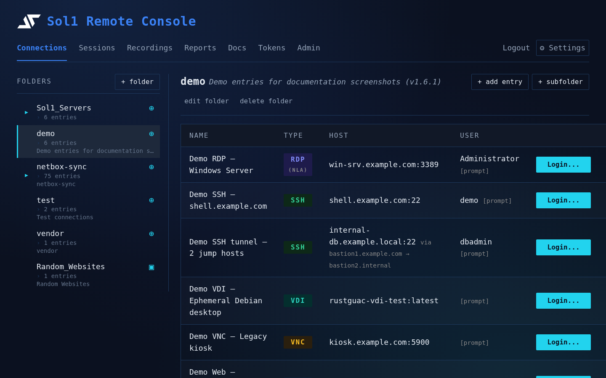

# rustguac

[](https://github.com/sol1/rustguac/actions/workflows/ci.yml)
[](https://github.com/sol1/rustguac/releases/latest)
[](LICENSE)
[](https://hub.docker.com/r/sol1/rustguac)

A lightweight Rust replacement for the Apache Guacamole Java webapp. Browser-based SSH, RDP, VNC, SPICE, Proxmox VE consoles, web browsing, and VDI desktop containers through [guacd](https://github.com/apache/guacamole-server).

No Java. No Tomcat. Single binary + guacd.

**Website:** [sol1.github.io/rustguac-website](https://sol1.github.io/rustguac-website/), with a tour of the web UI, a quick start and how rustguac compares with the Guacamole webapp.



## Architecture

```
Browser (HTML/JS)
    |
    | WebSocket over HTTPS
    v
rustguac (Rust, axum)
    |
    | TLS (Guacamole protocol)
    v
guacd (C, from guacamole-server)
    |
    +---> SSH server
    +---> RDP server
    +---> VNC server
    +---> SPICE server (libvirt/QEMU displays)
    +---> Proxmox VE VM console (SPICE via the PVE spiceproxy API)
    +---> Xvnc + Chromium (web browser sessions)
    +---> Docker container + xrdp (VDI desktop sessions)
```

## Features

### Session types

| Type | Description |
|------|-------------|
| **SSH** | Browser-based terminal with password, private key, or ephemeral keypair auth. SFTP file transfer. |
| **RDP** | Windows/Linux RDP with auto-fit resize, Kerberos NLA, RemoteApp/RAIL, H.264 passthrough, GFX pipeline, multi-monitor, console (admin) sessions, per-entry or per-browser keyboard layouts. |
| **VNC** | Connect to any VNC server (KVM/IPMI consoles, remote desktops, VM displays), with network presets (LAN/WAN/slow link) and optional display resize. |
| **SPICE** | Direct SPICE displays (libvirt/QEMU consoles) with TLS, CA verification, certificate-subject pinning, and SPICE-proxy support. |
| **Proxmox VE** | VM consoles brokered through the Proxmox API. One-time SPICE tickets fetched just-in-time at connect (only the API token is stored), node auto-detected from the VM ID, and SSH-tunnel aware. |
| **Web** | Headless Chromium on Xvnc with native autofill, domain allowlisting, login script automation. |
| **VDI** | Ephemeral Docker desktop containers per user. Persist after disconnect, auto-cleanup on idle. |

### Security & authentication

- **OIDC single sign-on**: Authentik, Google, Okta, Keycloak, or any OpenID Connect provider
- **Roles and permissions**: built-in admin, poweruser, operator and viewer roles, plus custom roles built from individual permissions. OIDC groups map to roles (a user in several mapped groups gets all of them), with optional role sync at login
- **API keys**: SHA-256 hashed admin keys with IP allowlists, expiry and an optional role, plus personal user tokens capped at a role
- **Vault-backed connections**: credentials in HashiCorp Vault or OpenBao KV v2, never reach the browser (see [Requirements](#requirements)). AppRole, workload JWT, mTLS or an agent-managed token, and optionally separate Vaults for shared and instance-local entries so one going down doesn't take the other with it
- **Audit logs**: admin changes, address book changes, API token activity and CLI actions
- **TLS everywhere**: HTTPS for clients, TLS between rustguac and guacd
- **CIDR allowlists**: per-protocol network restrictions for session targets
- **Per-entry clipboard control**: disable copy and/or paste for data loss prevention
- **Rate limiting**: optional per-IP, per-endpoint limits
- **Session recording**: Guacamole format with playback UI, disk rotation, per-entry limits

### Connectivity

- **Multi-hop SSH tunnels**: chain jump hosts/bastions to reach isolated networks (all session types, including the Proxmox API and console hops)
- **Session sharing**: share links for view-only or collaborative access, plus admin shadowing
- **Headless API integration**: create a session over the REST API and hand a browser a ready-to-open URL via a single-use WebSocket ticket, with no OIDC login and no API key in the browser (see [Connecting to a session](docs/api.md#connecting-to-a-session))
- **Encrypted file transfer**: LUKS-encrypted per-session drive storage (RDP), SFTP (SSH)
- **Credential variables**: shared credentials across connections entries

### VDI desktop containers

- **Docker-based**: one container per user, deterministic naming, BYO image
- **Persist after disconnect**: reconnect to the same desktop within idle timeout
- **Logout detection**: desktop logout stops the container, tab close preserves it
- **Session thumbnails**: live preview in the connections, click to reconnect
- **Persistent home directories**: bind-mounted user data survives container restarts
- **Per-entry resource limits**: CPU, memory, idle timeout per connections entry
- **VdiDriver trait**: extensible for downstream forks (Nomad, Proxmox, cloud)

### UI

- **Connections** with folder-based organisation, per-folder group and user access, search and Favourites
- **Active Sessions** with live thumbnail previews, sharing, and Terminate all
- **Fit or actual size** display, with scroll bars when a remote screen is larger than the window
- **Admin page** for users, group mappings, roles and the audit log
- **Session ended overlay** with Reconnect/Close buttons
- **Clipboard panel controls** (Home + Fullscreen)
- **8 built-in themes** with CSS gradient backgrounds, or configure your own
- **Reports page** with session analytics, history, and CSV export

## Requirements

| Component | Status | Notes |
|-----------|--------|-------|
| guacd | Bundled | Built from `apache/guacamole-server`, ships in the .deb and Docker image. No separate install. |
| **Vault or OpenBao** | **Required for the Connections UI** | Stores connection entries and credentials server-side. Without it the Connections page is unavailable and users can only run ad-hoc sessions via the API. Use [`contrib/vault-quickstart.sh`](contrib/vault-quickstart.sh) for one-command setup (auto-detects `vault` or `bao`, supports `--dev` and `--local` modes). |
| OIDC provider | Optional | For SSO. API-key auth works on its own. Authentik/Google/Okta/Keycloak/JumpCloud all tested. |
| Docker | Optional | Only needed for VDI desktop containers. |

### Supported browsers

The client runs in any modern browser (Chrome, Firefox, Edge, Safari, Chromium, Brave). One caveat applies only to **H.264-accelerated RDP**, which is opt-in per connection (the per-entry H.264 toggle, off by default):

- **Standard connections** (SSH, RDP, VNC, web sessions, VDI) work in every modern browser.
- **H.264-accelerated connections** need a browser that can decode H.264 through the WebCodecs API. **Chrome** and **Firefox** work. Open-source **Chromium** and **Brave** builds without the bundled H.264 codec, and older Safari, render a blank display on those connections. Leave H.264 off (the default) for universal browser support, or use Chrome or Firefox where it is enabled.

## Quick start

### Debian 13 (.deb)

Pre-built packages for amd64 and arm64 are available from [Releases](https://github.com/sol1/rustguac/releases):

```bash
sudo apt install ./rustguac_*.deb
/opt/rustguac/bin/rustguac --config /opt/rustguac/config.toml add-admin --name admin
sudo systemctl enable --now rustguac
```

### Docker

```bash
docker pull sol1/rustguac:latest
docker run --rm --entrypoint cat sol1/rustguac:latest /opt/rustguac/seccomp-chromium.json > seccomp-chromium.json
docker run -d -p 8089:8089 --security-opt seccomp=seccomp-chromium.json sol1/rustguac:latest
```

The seccomp profile lets Chromium's sandbox start for web browser sessions; see [Web sessions: Running under Docker](docs/web-sessions.md#running-under-docker).

For VDI support, mount the Docker socket:

```bash
docker run -d -p 8089:8089 \
  --security-opt seccomp=seccomp-chromium.json \
  -v /var/run/docker.sock:/var/run/docker.sock \
  --group-add $(getent group docker | cut -d: -f3) \
  sol1/rustguac:latest
```

### Other distributions

Pre-built packages are provided for Debian 13. For other distributions, build from source:

```bash
sudo ./install.sh
```

See the [Installation guide](docs/installation.md) for full details including Docker Compose, TLS setup, and development builds.

### VDI setup

VDI requires Docker on the host:

```bash
curl -fsSL https://get.docker.com | sh
sudo usermod -aG docker rustguac
sudo systemctl restart rustguac
```

Add `[vdi]` to your config and create a VDI entry in the connections. See [VDI Desktop Containers](docs/vdi.md) for image requirements and configuration.

## Documentation

### Getting started
- [Overview](docs/overview.md): what rustguac is, session types, architecture
- [Installation](docs/installation.md): Debian packages, Docker, bare-metal, development builds
- [Configuration](docs/configuration.md): TOML config reference with all sections
- [Deployment Guide](docs/deployment-guide.md): step-by-step production setup

### Features
- [Roles & Access Control](docs/roles-and-access-control.md): OIDC, roles, group mappings, API tokens
- [Web Browser Sessions](docs/web-sessions.md): autofill, domain allowlisting, login scripts
- [SPICE and Proxmox VE Sessions](docs/spice-and-proxmox.md): SPICE displays, Proxmox VE consoles, API tokens, TLS, troubleshooting
- [VDI Desktop Containers](docs/vdi.md): Docker desktops, image requirements, persistent homes
- [RDP Video Performance](docs/rdp-video-performance.md): H.264 passthrough, GFX pipeline, xrdp tuning
- [RDP H.264 Passthrough](docs/rdp-h264.md): enabling it, and the Windows host settings it requires
- [Credential Variables](docs/credential-variables.md): shared credentials across entries
- [Reports](docs/reports.md): session analytics, history, CSV export
- [Themes](docs/themes.md): built-in presets and your own branding

### Integration & reference
- [Integrations](docs/integrations.md): OIDC providers, Vault/OpenBao, LUKS drives, SSH tunnels, Kerberos, Knocknoc
- [Reverse Proxies](docs/reverse-proxies.md): HAProxy, nginx, Caddy, Apache, Traefik, and WebSockets over HTTP/2
- [NetBox](docs/netbox.md): connections sync via custom fields and webhooks
- [Security](docs/security.md): TLS, rate limiting, headers, audit logging, hardening
- [API Reference](docs/api.md): REST API endpoints, the session connection flow, and headless ws-ticket integration
- [Migration from Apache Guacamole](docs/migration.md): MySQL/MariaDB to Vault

## Commercial support

Commercial support for rustguac is available from [Sol1](https://www.sol1.com.au).

## License

Apache License 2.0. See [LICENSE](LICENSE) for details.
